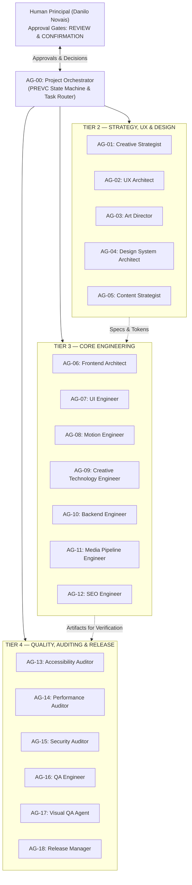

# GHOST PORTFOLIO 2.0 — MULTI-AGENT ECOSYSTEM MANIFEST

**Phase:** 03 — Agent Ecosystem Architecture  
**Total Logical Agents:** 19 Specialized Personas across 4 Operational Tiers  
**Execution Principle:** Logical Role Specialization with Selective Task-Based Activation (Zero Unnecessary Concurrent Duplication)

---

## 1. 4-Tier Agent Hierarchy

---

## 2. Canonical Agent Roster (19 Agents)

| Agent ID | Handle | File Path | Tier | Primary Skills | Scoped MCP / Tool Permissions |
| :--- | :--- | :--- | :--- | :--- | :--- |
| **AG-00** | `@orchestrator` | `.agents/agents/orchestrator.md` | Tier 1 — Orchestration | `portfolio-context` | Read, Write (`.context/`), GitHub MCP, Subagent Router |
| **AG-01** | `@creative-strategist` | `.agents/agents/creative-strategist.md` | Tier 2 — Strategy & Design | `creative-strategy`, `portfolio-context` | Read, Write (`.context/`, `docs/`) |
| **AG-02** | `@ux-architect` | `.agents/agents/ux-architect.md` | Tier 2 — Strategy & Design | `portfolio-ux-audit`, `portfolio-context` | Read, Write (`.context/`), Figma MCP (Read) |
| **AG-03** | `@art-director` | `.agents/agents/art-director.md` | Tier 2 — Strategy & Design | `art-direction`, `ghost-design-system` | Read, Write (`.context/`), Figma MCP |
| **AG-04** | `@design-system-architect` | `.agents/agents/design-system-architect.md` | Tier 2 — Strategy & Design | `ghost-design-system`, `component-engineering` | Read, Edit (`src/styles/`, `src/components/ui/`), Context7 |
| **AG-05** | `@content-strategist` | `.agents/agents/content-strategist.md` | Tier 2 — Strategy & Design | `case-study-builder`, `creative-strategy` | Read, Edit (`src/lib/data/content/`, `.context/`) |
| **AG-06** | `@frontend-architect` | `.agents/agents/frontend-architect.md` | Tier 3 — Engineering | `nextjs-architecture`, `component-engineering` | Read, Edit (`src/`, `next.config.ts`, `tsconfig.json`), Context7 |
| **AG-07** | `@ui-engineer` | `.agents/agents/ui-engineer.md` | Tier 3 — Engineering | `component-engineering`, `ghost-design-system` | Read, Edit (`src/components/`, `src/app/`), Context7 |
| **AG-08** | `@motion-engineer` | `.agents/agents/motion-engineer.md` | Tier 3 — Engineering | `motion-engineering`, `ghost-design-system` | Read, Edit (`src/components/motion/`, `src/config/motion.ts`), Context7 |
| **AG-09** | `@creative-tech-engineer` | `.agents/agents/creative-tech-engineer.md` | Tier 3 — Engineering | `threejs-experience`, `motion-engineering` | Read, Edit (`src/components/three/`, `public/models/`), Context7 |
| **AG-10** | `@backend-engineer` | `.agents/agents/backend-engineer.md` | Tier 3 — Engineering | `nextjs-architecture`, `security-review` | Read, Edit (`src/lib/supabase/`, `src/lib/data/`, `scripts/`), Supabase MCP (Read-First), Context7 |
| **AG-11** | `@media-pipeline-engineer` | `.agents/agents/media-pipeline-engineer.md` | Tier 3 — Engineering | `media-optimization` | Read, Edit (`src/components/media/`, `scripts/audit-assets.ts`), CLI |
| **AG-12** | `@seo-engineer` | `.agents/agents/seo-engineer.md` | Tier 3 — Engineering | `seo-optimization`, `nextjs-architecture` | Read, Edit (`src/lib/seo/`, `src/app/sitemap.ts`, `src/app/robots.ts`), Context7 |
| **AG-13** | `@accessibility-auditor` | `.agents/agents/accessibility-auditor.md` | Tier 4 — Quality & Governance | `accessibility-audit`, `portfolio-ux-audit` | Read, Playwright MCP, Chrome DevTools MCP |
| **AG-14** | `@performance-auditor` | `.agents/agents/performance-auditor.md` | Tier 4 — Quality & Governance | `performance-audit`, `media-optimization` | Read, Chrome DevTools MCP (Lighthouse/Trace), CLI |
| **AG-15** | `@security-auditor` | `.agents/agents/security-auditor.md` | Tier 4 — Quality & Governance | `security-review` | Read, CLI (`audit`), GitHub MCP |
| **AG-16** | `@qa-engineer` | `.agents/agents/qa-engineer.md` | Tier 4 — Quality & Governance | `deployment-validation`, `visual-regression` | Read, Edit (`tests/`), Playwright MCP, CLI (`pnpm test`) |
| **AG-17** | `@visual-qa-agent` | `.agents/agents/visual-qa-agent.md` | Tier 4 — Quality & Governance | `visual-regression`, `portfolio-ux-audit` | Read, Playwright MCP, Chrome DevTools MCP |
| **AG-18** | `@release-manager` | `.agents/agents/release-manager.md` | Tier 4 — Quality & Governance | `deployment-validation`, `security-review` | Read, CLI (`pnpm build`), GitHub MCP, Vercel/Cloudflare CLI (Requires Human Gate) |

