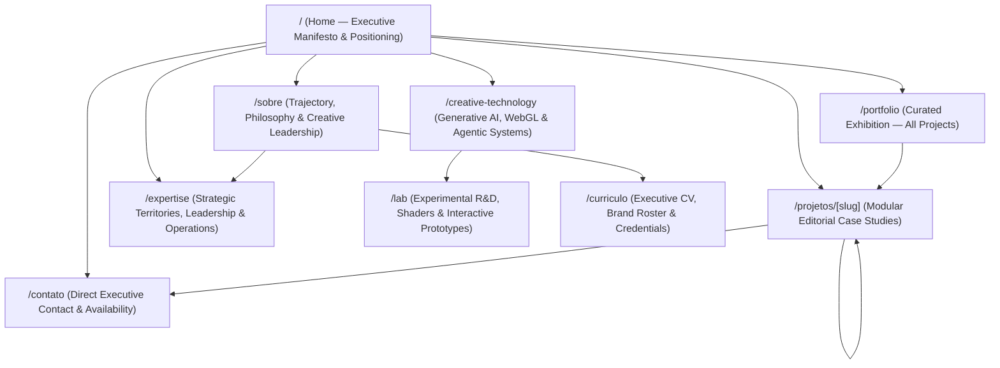

# INFORMATION ARCHITECTURE — GHOST PORTFOLIO 2.0

**Phase:** 01 — UX & Information Architecture  
**Active Personas:** UX Architect (`AG-02`), Creative Strategist (`AG-01`), Content Strategist (`AG-05`)  
**Status:** Blueprint Specification (Pending Human Approval)

---

## 1. Site Map & Route Hierarchy

`GHOST-PORTFOLIO-2.0` transitions from a fragmented route map to a cohesive, 9-route editorial ecosystem designed for executive discovery, deep case reading, and technological proof.

### Route Specification Table

| Route | Legacy Equivalent (`PORTFOLIO-DANILO-FINAL`) | Primary Role | Rendering Strategy |
| :--- | :--- | :--- | :--- |
| `/` | `/` | Executive manifesto, positioning, featured flagship cases, territories, client roster, and conversion CTA. | Static / ISR with tagged revalidation |
| `/sobre` | `/sobre` + `/o-que-me-move` | Consolidates personal narrative, creative philosophy (*O Que Me Move*), and leadership trajectory into one powerful story. | Static / ISR |
| `/portfolio` | `/portfolio` | Filterable exhibition of all published projects across the 5 Strategic Territories (Grid + Index List views). | Static / ISR |
| `/projetos/[slug]` | `/projects/[slug]` | Deep editorial case study built on the 8-stage modular block engine (with 301 redirect from `/projects/[slug]`). | `generateStaticParams` + ISR |
| `/expertise` | *(New Route)* | Detailed breakdown of Danilo's capabilities: Creative Direction, Brand Strategy, Creative Ops, and Design Systems. | Static |
| `/creative-technology` | *(New Route)* | Dedicated showcase of Generative AI workflows, multi-agent systems, R3F/WebGL architecture, and creative coding. | Static |
| `/lab` | *(New Route)* | Sandbox for experimental shaders, interactive prototypes, and R&D explorations. | Static + Lazy Client Islands |
| `/curriculo` | *(New Route)* | Structured, printable/downloadable Executive CV with career timeline (`experiences` table), skills, and brand roster. | Static / ISR |
| `/contato` | `/contato` | Direct executive conversion channel (Email, WhatsApp, LinkedIn, project inquiry brief). | Static + Server Action |

> [!IMPORTANT]
> **SEO Continuity Rule:** Legacy URLs `/projects/[slug]` and `/o-que-me-move` will have permanent `308`/`301` redirects in `next.config.ts` to `/projetos/[slug]` and `/sobre#manifesto` so zero search equity or shared links are broken.

---

## 2. Page-Level Section Blueprints

### 2.1 Home (`/`) — 9-Section Executive Flow
1. **01. Hero Manifesto:** Authorial positioning statement + role taxonomy + primary `<AntigravityCTA />` over subtle atmospheric canvas.
2. **02. Executive Thesis:** Concise introduction bridging strategy, leadership, and technology.
3. **03. Flagship Cases (Selected Works):** 4–5 curated high-impact cases with editorial framing and hover video previews.
4. **04. Territories of Practice:** Interactive accordion/grid of the 5 core territories (`Branding`, `Campaigns`, `Motion`, `Web & Digital`, `Creative Tech & AI`).
5. **05. Creative Leadership & Operations:** How Danilo structures teams, design systems, and high-velocity creative workflows.
6. **06. Creative Technology & AI Highlight:** Teaser of AI-native workflows and real-time interactive craft, linking to `/creative-technology`.
7. **07. Brands & Market Footprint:** Curated wall of verified brands (Swift, Nestlé, Nivea, Ambev, Zé Delivery, Pernod Ricard, Algar Telecom, Mapfre, AON, O Boticário, Grupo Iguatemi, Unilever).
8. **08. Trajectory Snapshot:** Executive career synthesis linking to `/sobre` and `/curriculo`.
9. **09. Executive Contact CTA:** High-contrast closing invitation to collaborate.

### 2.2 Global Navigation & Wayfinding Architecture
- **Desktop Header (`--z-layer-header: 55`):**
  - Left: Wordmark / Monogram (`DANILO NOVAIS` + subtle `PPSupplyMono` role indicator).
  - Center/Right Primary Links: `Portfolio`, `Sobre`, `Expertise`, `Creative Tech`, `Lab`, `Currículo`.
  - Far Right Action: Compact `<AntigravityCTA />` (`Contato →`).
- **Mobile Navigation (`--z-layer-mobile-header: 80` & `--z-layer-mobile-menu: 90`):**
  - Fixed top bar with safe-area padding and minimum `48x48px` accessible menu trigger.
  - Full-screen curtain menu using `GHOST_EASE` with keyboard focus trap (`Escape` to close), direct route links, and quick-action social/WhatsApp/email pills at the footer.
- **Global Footer:**
  - Sitemap navigation, direct contact coordinates (`danilo@portfoliodanilo.com`, WhatsApp, LinkedIn), colophon (`Ghost Design System 2.0`), and live local time in São Paulo (`America/Sao_Paulo` in `PPSupplyMono`).

