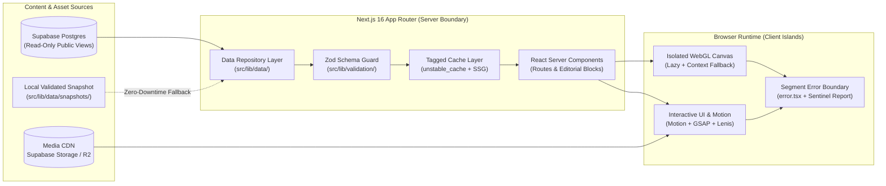

# TECHNICAL ARCHITECTURE — GHOST PORTFOLIO 2.0

**Phase:** 02 — Technical Architecture  
**Active Personas:** Frontend Architect (`AG-06`), Backend Engineer (`AG-10`), Creative Technology Engineer (`AG-09`), Security Auditor (`AG-15`)  
**Context7 Validation:** Validated against `/vercel/next.js/v16.4.5`, `/tailwindlabs/tailwindcss.com` (v4), and `/supabase/ssr/v0.12.7`  
**Status:** Blueprint Specification (Pending Human Approval)

---

## 1. Architectural Philosophy: Decoupled, Static-First & Resilient

`PORTFOLIO-DANILO-FINAL` suffered from coupling the public showcase, admin CMS mutations, experimental scripts, and multiple cloud deployment adapters into a single runtime.

`GHOST-PORTFOLIO-2.0` introduces a **Clean Layered Architecture**:
1. **Phase 1 Separation of Concerns:** The public portfolio is 100% decoupled from `/admin` CRUD complexity. Public pages render via **Next.js 16 Server Components (RSC)** using static generation (`generateStaticParams`) and tagged cache revalidation (`unstable_cache` / `revalidateTag`), backed by a validated local content snapshot fallback so the public experience has **zero runtime single-point-of-failure** on database latency.
2. **Progressive Client Islands:** Heavy libraries (Three.js/R3F, GSAP ScrollTrigger, interactive video players) are strictly isolated inside Client Component islands loaded via `next/dynamic` (`ssr: false` where appropriate) and gated by `IntersectionObserver` + `prefers-reduced-motion`.
3. **Strict Validation Boundary:** Every data payload (whether from Supabase or local TypeScript/JSON manifests) passes through a **Zod 4** validation layer (`src/lib/validation/`) before reaching any React component.

---

## 2. Validated Technology Stack & Justification

| Layer | Technology | Target Version | Architectural Justification |
| :--- | :--- | :--- | :--- |
| **Framework** | **Next.js (App Router)** | `16.4.x` | Native React Server Components, `generateStaticParams`, `unstable_cache`, route-segment `error.tsx` boundaries, and Turbopack raw shader imports. |
| **UI Runtime** | **React** | `19.3.x` | Server Actions, concurrent rendering, `use()` hook, and zero-bundle Server Components. |
| **Language** | **TypeScript** | `~7.0.x` / `5.8+` | Strict static typing (`strict: true`, `noUncheckedIndexedAccess: true`) for content models, blocks, and tokens. |
| **Styling** | **Tailwind CSS v4** | `4.3.x` | CSS-first `@theme` token engine (`src/styles/globals.css`), zero-runtime CSS variables, LightningCSS optimization. |
| **UI Motion** | **Motion (Framer Motion)** | `^14.12.x` | Declarative layout transitions, presence animations, and accessible `useReducedMotion()` hooks. |
| **Scroll Choreography** | **GSAP + Lenis** | `^3.15.x` / `^1.3.x` | Timeline-driven scroll pinning and smooth inertial scrolling synchronized via `gsap.ticker`. |
| **3D / WebGL** | **Three.js + R3F** | `^0.187.x` / `^9.8.x` | Isolated shader canvases (`Grainient`, atmospheric fields) with automatic WebGL context-loss fallback. |
| **Data & Storage** | **Supabase + CDN** | `@supabase/supabase-js` `^2.119.x` | Read-only Postgres content repository + Supabase Storage / Cloudflare R2 CDN (`assets.portfoliodanilo.com`). |
| **Schema Validation** | **Zod** | `^4.6.x` | Compile-time and runtime contract validation for projects, case blocks, and environment variables. |
| **Quality & Testing** | **Playwright + Vitest/Jest** | `^1.65.x` | E2E user journeys, visual regression snapshots, Axe accessibility audits, and unit tests. |
| **Package Manager** | **pnpm** | `10.x / 12.x` | Deterministic lockfile, strict phantom-dependency prevention. |

> **Dependencies Intentionally Omitted from Phase 1 Public Runtime:**  
> `html5-qrcode`, `openai` (in client bundle), `react-hook-form` (only loaded if interactive contact form requires it; Server Action + native validation preferred), `pg` (moved strictly to CLI migration/audit scripts), `firebase-tools` (unless Firebase Hosting is explicitly chosen over Vercel/Cloudflare in Phase 09).

---

## 3. System & Data Flow Architecture

---

## 4. Caching, Rendering & Resilience Strategy

1. **Build-Time Static Prerendering (`SSG`):**
   - All 9 core routes and all `/projetos/[slug]` pages are prerendered at build time via `generateStaticParams()`.
2. **Tagged Incremental Revalidation (`ISR`):**
   - Data fetchers in `src/lib/data/projects.ts` wrap queries in `unstable_cache(..., ['projects'], { tags: ['projects', 'content'], revalidate: 3600 })`.
   - Protected webhook `/api/revalidate` allows instant cache invalidation via `revalidateTag('projects')` when content updates in Supabase.
3. **Dual-Source Resilience (Snapshot Fallback):**
   - During build/sync (`pnpm content:sync`), verified Supabase rows are exported to `src/lib/data/snapshots/projects.snapshot.json`. If a live Supabase query times out or fails, the repository layer transparently serves the validated snapshot and logs a warning.
4. **Error Boundary & WebGL Isolation Protocol:**
   - Every route segment under `src/app/(website)/` includes an `error.tsx` client boundary (`'use client'`) with a `retry()` recovery trigger.
   - Every `<Canvas>` component is wrapped in `<WebGLErrorBoundary fallback={<AtmosphericCSSFallback />}>` so devices without hardware acceleration or lost WebGL contexts render an elegant CSS gradient/poster without crashing the page.

